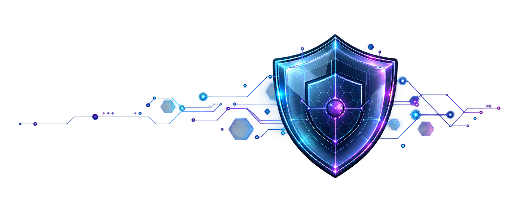

---

## Perfil

Sou desenvolvedor interessado em **cibersegurança**, **desenvolvimento seguro**, **arquitetura de software** e **desenvolvimento de jogos**. Gosto de transformar ideias técnicas em projetos práticos, valorizando qualidade, privacidade e segurança desde o início.

Atualmente, estou aprofundando meus conhecimentos em **cibersegurança** e **shaders avançados**, com atenção a boas práticas, privacidade e responsabilidade na tecnologia.

## Áreas de interesse

| Cibersegurança | Engenharia de software | Desenvolvimento de jogos |
|:---:|:---:|:---:|
| Fundamentos de segurança e desenvolvimento seguro | Arquitetura e aplicações práticas | Unity, Unreal Engine e shaders |
| Aprendizado responsável e proteção de sistemas | Qualidade, manutenção e experiência de uso | C#, C++, Lua e ferramentas relacionadas |

## Tecnologias e ferramentas

## Projetos em destaque

- **[Portal Wi-Fi Pago](https://github.com/khallendevs/portal-wifi-pago)** — portal cativo e painel administrativo para Android/Termux, com gerenciamento de acesso Wi-Fi.
- **[VaultFile](https://github.com/khallendevs/VaultFile)** — projeto de aplicativo Android, identificado como Alpha no repositório.
- **[Fossbilling PIX via Mercado Pago](https://github.com/khallendevs/Fossbilling-PIX-via-MercadoPago)** — plugin PHP de integração entre FossBilling e Mercado Pago.

## GitHub em números

---

**Construindo com curiosidade. Protegendo com responsabilidade.**

